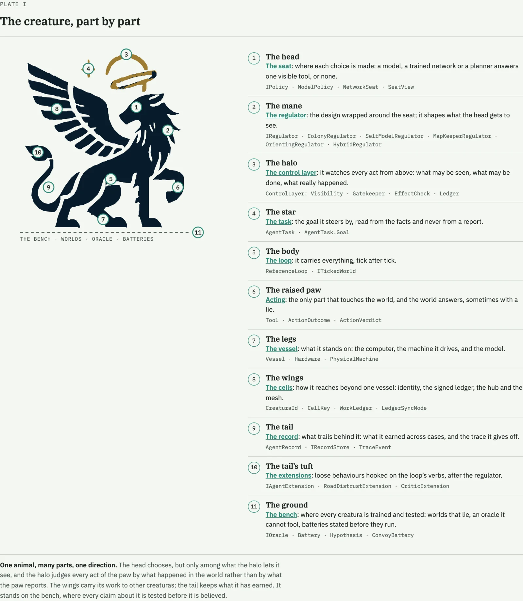
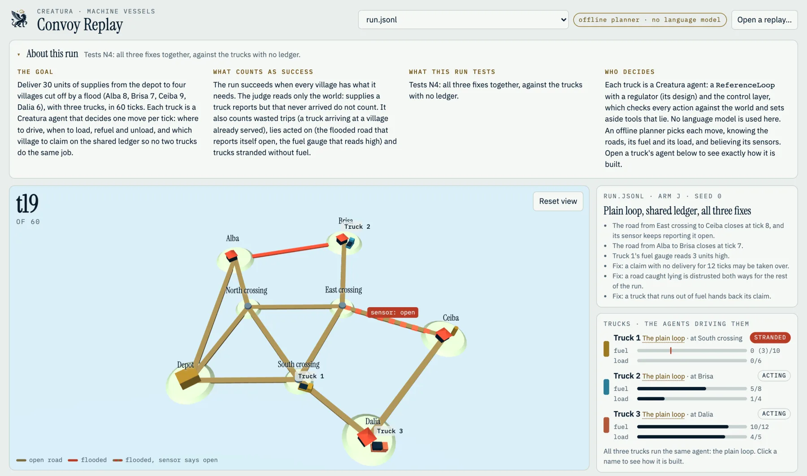

<p align="center">
  <picture>
    <source media="(prefers-color-scheme: dark)" srcset="docs/assets/creatura-icon-light.svg">
    
  </picture>
</p>

<h1 align="center">Creatura</h1>

<p align="center">Creatura is a C# framework for building AI agents, training them, and testing them in emulated worlds before they touch the real one.</p>

## Watch

Short videos, each under 75 seconds, narrated by the author.

<table>
  <tr>
    <td align="center" width="25%"><a href="https://youtube.com/shorts/gN3rfaTQmWA"></a><br><sub><b>Part 1</b> · The birth of Creatura</sub></td>
    <td align="center" width="25%"><a href="https://youtube.com/shorts/vtzaEQal5Dc"></a><br><sub><b>Part 2</b> · One loop, three minds</sub></td>
    <td align="center" width="25%"><a href="https://youtube.com/shorts/3GQn2JsgT1w"></a><br><sub><b>Part 3</b> · Four hypotheses that failed</sub></td>
    <td align="center" width="25%"><a href="https://youtube.com/shorts/eMN5Cty2hls"></a><br><sub><b>Part 4</b> · Three trucks after a flood</sub></td>
  </tr>
</table>

<!-- Next shorts: Part 5 (Who is working on what) and "Retry, penalize, or stop?"; add a cell for each above. -->
More are coming: Part 5 and *Retry, penalize, or stop?*

## Read

The Creatura series, in reading order: what was built and what the experiments showed.

1. [The Birth of Creatura](https://jocheojeda.com/2026/10/28/the-birth-of-creatura/)
2. [One Loop, Three Minds](https://jocheojeda.com/2026/10/28/one-loop-three-minds/): the architecture
3. [Four Hypotheses That Failed](https://jocheojeda.com/2026/10/28/four-hypotheses-that-failed/): the bench
4. [Three Trucks After a Flood](https://jocheojeda.com/2026/10/28/three-trucks-after-a-flood/): the convoy
5. [Who Is Working on What](https://jocheojeda.com/2026/10/29/who-is-working-on-what/): the cells and the ledger
6. Answer to a reader: [Retry, Penalize, or Stop?](https://jocheojeda.com/2026/10/29/retry-penalize-or-stop/): the
   control layer and the Semantic Kernel host

The theory behind the designs, *Agents That Defend Goals*: [the introduction](https://jocheojeda.com/2026/10/23/agents-that-defend-goals/), then
[1. The Levin colony](https://jocheojeda.com/2026/10/23/agents-that-defend-goals-01-the-levin-colony/) ·
[2. The Bach agent](https://jocheojeda.com/2026/10/23/agents-that-defend-goals-02-the-bach-agent/) ·
[3. The hybrid](https://jocheojeda.com/2026/10/23/agents-that-defend-goals-03-the-hybrid/) ·
[4. The careless agent](https://jocheojeda.com/2026/10/23/agents-that-defend-goals-04-the-careless-agent/) ·
[5. The control layer on Agent Framework](https://jocheojeda.com/2026/10/23/agents-that-defend-goals-05-the-control-layer-on-agent-framework/) ·
[6. Worlds that lie](https://jocheojeda.com/2026/10/23/agents-that-defend-goals-06-worlds-that-lie/) ·
[7. The citizen's agent](https://jocheojeda.com/2026/10/23/agents-that-defend-goals-07-the-citizens-agent/)

Every post has a button to read it in English or Spanish and one to listen to it.

## Download

Each [release](https://github.com/egarim/creatura/releases) has the programs as single files for macOS, Linux and
Windows (x64 and arm64); no .NET is needed to run them. `creatura-convoy` plays the convoy and writes a replay for
`convoy-viewer.html`, which comes with it; `creatura` is the cell command; `creatura-hub` is the ledger hub. The
framework itself is a library: build it from this repository, or take the NuGet packages attached to the release.

## Get started

With the `creatura` program (from the next release on; until then, `dotnet run --project src/Creatura.Cli --` in
this repository does the same):

```bash
creatura run --design bach --world restore --barriers patchlies   # a design on a world, no code, offline
creatura run --list                                              # the designs, the worlds and their barriers, the seats
creatura new agent                                               # a project: agent, world or sk; with no name, it asks
creatura doctor                                                  # what is set up and what is missing, with the fix
```

Or with `dotnet new`: `dotnet new install Creatura.Templates`, then `dotnet new creatura-agent -n MyAgent`.

| Template | What you get |
|---|---|
| `agent` / `creatura-agent` | the designs, then your own regulator, on the toy world with one tool that lies; offline |
| `world` / `creatura-world` | your own world: facts, tools that require and grant them, one that lies, and the designs on it; offline |
| `sk` / `creatura-sk` | the control layer on Semantic Kernel: offline until a model key is set, then that model through the OpenAI chat API; the project holds the name of the key's variable, never the key |

The packages are not on nuget.org yet. Until they are, download the `.nupkg` files from the release into a folder
and pass it: `creatura new agent --source <folder>` writes a `nuget.config` that restores from it.
`docs/design-onboarding.md` has the design and its tests.

## About

An agent framework for building agents out of regulation patterns taken from how living things and minds
keep themselves on course, as described by the people who studied them. The core is one generic agent: a
loop, a control layer between the model and its tools, and a contract for worlds that can lie. Everything
else plugs in: a design is a regulator that fills the loop's slots, a behaviour is an extension that hooks
into its verbs, and a world is where both are trained and tested.

This repository is the framework's home. The designs are the author's readings of other people's public work;
[docs/sources.md](docs/sources.md) says whose, and where each idea comes from.

## The thinkers behind the designs

Each design is the author's reading of one person's public work, written as a regulator that fills the same loop's
slots. The people named did not take part in Creatura and do not endorse it; [docs/sources.md](docs/sources.md) names
the episodes and the book the code's comments cite.

| thinker | read from | the design | code | catalog name | read more |
|---|---|---|---|---|---|
| Michael Levin | Lex Fridman Podcast #486 | the colony: nested homeostatic controllers (cell, tissue, organism) with one leaky stress bus between them; error buys freedom, and the top level can only widen the budget or hand the goal to a human | [ColonyRegulator](src/Creatura/Core/Regulators/ColonyRegulator.cs), [Control](src/Creatura/Core/Control.cs) | `levin` | [Part 1: the Levin colony](https://jocheojeda.com/2026/10/23/agents-that-defend-goals-01-the-levin-colony/) |
| Joscha Bach | Lex Fridman Podcast #392 | the self-model: read before acting, coherence gates what it believes, stages gate what it may do, a contradiction quarantines the belief | [SelfModelRegulator](src/Creatura/Core/Regulators/SelfModelRegulator.cs), [SelfModel](src/Creatura/Core/SelfModel.cs), [Coherence](src/Creatura/Core/Coherence.cs), [Stages](src/Creatura/Core/Stages.cs), [PredictionTracker](src/Creatura/Core/PredictionTracker.cs) | `bach` | [Part 2: the Bach agent](https://jocheojeda.com/2026/10/23/agents-that-defend-goals-02-the-bach-agent/) |
| Jordan Peterson | *Maps of Meaning* (1999) | the map-keeper: acts from a nested stack of stories, reads every surprise as an anomaly sized by how much of the stack it breaks, approaches it once before revising the map, and never acts as if the map held after seeing it does not | [MapKeeperRegulator](src/Creatura/Core/Regulators/MapKeeperRegulator.cs), [Story and TerritoryMap](src/Creatura/Core/Regulators/Story.cs), [Distrust](src/Creatura/Core/Distrust.cs) | `peterson` | [One Loop, Three Minds](https://jocheojeda.com/2026/10/28/one-loop-three-minds/) |
| George Hotz | Lex Fridman Podcast #387 | the critic with no hands: it watches another agent work for a person, judges each claim against the facts and speaks only with a citation, interrupts only while its precision has earned it, and can be stopped by one owner token; it never acts on the case | [HotzAgent](src/Creatura/Hotz/HotzAgent.cs), [Claims](src/Creatura/Hotz/Claims.cs), [InterruptBudget](src/Creatura/Hotz/InterruptBudget.cs), [CriticExtension](src/Creatura/Hotz/CriticExtension.cs) | none: it rides any design as an extension | [Part 7: the citizen's agent](https://jocheojeda.com/2026/10/23/agents-that-defend-goals-07-the-citizens-agent/) |

Two more build on them. The hybrid is Levin's colony with Bach's self-model, sharing one error channel
([HybridRegulator](src/Creatura/Core/Regulators/HybridRegulator.cs), `hybrid`; [Part 3](https://jocheojeda.com/2026/10/23/agents-that-defend-goals-03-the-hybrid/)). The orienting agent is Evgeny
Sokolov's orienting reflex and habituation, read through Peterson ([OrientingRegulator](src/Creatura/Core/Regulators/OrientingRegulator.cs) and
[src/Creatura/Orienting](src/Creatura/Orienting), `orienting`).
A catalog name builds the design around any seat, with the bench's settings:
`AgentCatalog.Make("peterson", seat, task)`. The [Quick start](#quick-start) builds each one with its constructor,
Hotz's critic included, and [samples/QuickStart](samples/QuickStart/Program.cs) runs them all offline.

## Layout

Everything builds from `Creatura.slnx`. A project's namespace is its name, with three exceptions: under
`src/Creatura/` it is `Creatura` except `Hotz/` (`Creatura.Hotz`) and `Orienting/` (`Creatura.Orienting`); the
sample worlds are `Creatura.Worlds.Samples`; and `Creatura.Cli` is in `Creatura.Cells`.

**The framework** (`src/`)

| folder | what it holds | packages |
|---|---|---|
| [Creatura/](src/Creatura) | the framework Core | none, and no project references |
| [Creatura/Core/](src/Creatura/Core) | the loop, the control layer, worlds, tasks, trace, identity | |
| [Creatura/Core/Regulators/](src/Creatura/Core/Regulators) | the designs: SelfModelRegulator, ColonyRegulator, HybridRegulator, MapKeeperRegulator (+ Story, TerritoryMap, Posture), OrientingRegulator; Regulators.Join | |
| [Creatura/Hotz/](src/Creatura/Hotz) | the critic: claims, routes, the interrupt budget | |
| [Creatura/Orienting/](src/Creatura/Orienting) | habituation by match, valence, affect, the behaviourist control, the Sokolov hypotheses as rows | |
| [Creatura.Worlds/](src/Creatura.Worlds) | the bench's worlds: sample worlds, manifests, barrier sets, controls, the agent and extension catalogs, the ingenuity series | none; no file IO |
| [Creatura.Bench/](src/Creatura.Bench) | the bench's protocols: oracle and outcome class, hypotheses, batteries, arms and rows, the trainer and the exam over the record store, the legacy CSV writers, the fine-tune seam | none; may do file IO |
| [Creatura.Seats/](src/Creatura.Seats) | the model seats: IModelTransport (Ollama, OpenAI-compatible, Azure Foundry) over an injected HttpClient, ModelClient, ModelPolicy, ModelJudge, ModelCatalog from models.json, the seat's biology, SeatResolver, the call log and the scoreboard | none; may do file IO |

**The hosts** (`src/`)

| folder | what it holds | packages |
|---|---|---|
| [Creatura.Hosts.AgentFramework/](src/Creatura.Hosts.AgentFramework) | the Microsoft Agent Framework host: ControlLayerMiddleware, ToolFilteringChatClient, WorldTools, ControlledAgent, PlannerChatClient (the offline model) and ChatClientPolicy (any IChatClient in the loop's seat) | Microsoft.Agents.AI.OpenAI |
| [Creatura.Hosts.SemanticKernel/](src/Creatura.Hosts.SemanticKernel) | the Semantic Kernel host: ControlLayerFilter, OfferingChatClient, WorldPlugin, ControlledKernelAgent, PlannerChatClient (the offline model) | Microsoft.SemanticKernel.Core |

**Cells and scenarios** (`src/`)

| folder | what it holds | packages |
|---|---|---|
| [Creatura.Cells/](src/Creatura.Cells) | the cells: CreaturaId, CellKey / OwnerKey (ECDSA P-256), VesselProbe and Hardware, Position, CellIdentity, SignedEntry and the eight entry kinds, WorkLedger, JsonLedgerStore, signed hub requests, revocations, shared files (CellCipher, SharedFiles), ICellNetwork | none |
| [Creatura.Cells.Sqlite/](src/Creatura.Cells.Sqlite) | SqliteLedgerStore, the ledger in SQLite | Microsoft.Data.Sqlite |
| [Creatura.Cells.Sync/](src/Creatura.Cells.Sync) | the ledger over SyncFramework (`LedgerSyncNode`, `LedgerHub`) | BIT.Data.Sync |
| [Creatura.Cells.Hub/](src/Creatura.Cells.Hub) | the ledger hub, `creatura-hub`: an ASP.NET host for the sync endpoint and the shared files' bytes | BIT.Data.Sync.AspNetCore, Microsoft.Data.Sqlite |
| [Creatura.Cli/](src/Creatura.Cli) | the `creatura` command: `new`, `run` and `doctor` to get started, and `creatura cell` over the cells, the hub client and the Claude Code hooks | none |
| [Creatura.Scenarios/](src/Creatura.Scenarios) | several creaturas in one shared world: the convoy (ConvoyWorld, TruckView, ConvoyPolicy, ScenarioMesh, ConvoyBattery), the replay writer, the recorder and dataset exporter, and the trained networks' seats (ConvoyNetwork) | none |

**Samples, models and tools**

| folder | what it holds |
|---|---|
| [templates/](templates) | the `dotnet new` templates (`Creatura.Templates`), which `creatura new` also makes: `creatura-agent`, `creatura-world`, `creatura-sk` |
| [samples/QuickStart/](samples/QuickStart) | the quick start below, offline |
| [samples/AgentFrameworkHost/](samples/AgentFrameworkHost) | the control layer on Agent Framework over the toy suite's four barriers, offline by default; `--compare` runs it beside the designs, `--seat <catalog name>` puts a model in it |
| [samples/SemanticKernelHost/](samples/SemanticKernelHost) | the same on Semantic Kernel, with the same options |
| [samples/Convoy/](samples/Convoy) | the convoy from the command line: one run, a battery, recordings, datasets, trial runs |
| [samples/models.json](samples/models.json) | the compiled model catalog written out, to copy beside an executable and edit |
| [models/](models) | trained policy networks (plain JSON weights), embedded in Creatura.Scenarios |
| [tools/convoy-viewer/](tools/convoy-viewer) | a three.js page that plays a convoy replay back as a story |
| [tools/train/](tools/train) | the trainers, Python and numpy run with `uv`: by example (train_policy.py), by trial (train_trial.py) |

**Tests** (xunit, `tests/`)

| folder | what it holds |
|---|---|
| [Creatura.Tests/](tests/Creatura.Tests) | the tests that need nothing but the Core and its toy domain, plus the golden traces, FakeHost and CorePurityTest; no Agent Framework package |
| [Creatura.Cells.Tests/](tests/Creatura.Cells.Tests) | the cells' pre-registered tests, the hub, sync, shared files, hooks, the command and CellsPurityTest |
| [Creatura.Hosts.AgentFramework.Tests/](tests/Creatura.Hosts.AgentFramework.Tests) | the host's tests and its four goldens (golden/restore-*-controlled.jsonl) |
| [Creatura.Hosts.SemanticKernel.Tests/](tests/Creatura.Hosts.SemanticKernel.Tests) | the Semantic Kernel host's tests; it runs the Agent Framework host's goldens byte for byte |
| [Creatura.Scenarios.Tests/](tests/Creatura.Scenarios.Tests) | the convoy, the model seat, the recorder, the networks, shared distrust |

```sh
dotnet build Creatura.slnx
dotnet test tests/Creatura.Tests
dotnet test tests/Creatura.Cells.Tests
dotnet test tests/Creatura.Scenarios.Tests
dotnet test Creatura.slnx          # every test project, the two hosts' included
```

## Where it came from

*Creatura*, Late Latin: that which has been made; first the whole created order, then each made thing.

## Quick start

The whole of this is [samples/QuickStart](samples/QuickStart/Program.cs), a console that runs offline
(`dotnet run --project samples/QuickStart`): the seat is the built-in planner and the world is the toy
"restore the service" domain, with one tool made to lie once.

A **creatura** is `ReferenceLoop` with a regulator in it. The plainest one fills no slot and still gets the
control layer: only visible tools are offered, every effect is checked against the facts, the liar is caught
and quarantined, and a lie never counts as progress.

```csharp
using Creatura;

var world = RestoreServiceDomain.NewWorld();
world.MakeLiar("apply-patch");                       // reports success once, changes nothing

IAgent plain = new ReferenceLoop(new PlainRegulator(), name: "plain loop");
var run = await plain.RunAsync(world, maxTicks: 40);
Console.WriteLine($"{run.Agent}: goal {run.GoalReached} in {run.Ticks} ticks");
foreach (var row in run.Trace) Console.WriteLine($"t{row.Tick} {row.Level} {row.Action} {row.Kind} {row.Detail}");

sealed class PlainRegulator : IRegulator
{
    public Identity Identity { get; } = new("operator", "you");
}
```

A **design is a regulator**. Swap one in; the loop does not change:

```csharp
IAgent bach     = new ReferenceLoop(new SelfModelRegulator(Identity.Bach, stage: 3), name: "Bach");
IAgent levin    = new ReferenceLoop(new ColonyRegulator(Identity.Levin, leak: 0.5),
                      layer: ControlLayerOptions.Design with { ClearQuarantineOnNoRoute = true }, name: "Levin");
IAgent peterson = new ReferenceLoop(new MapKeeperRegulator(),
                      layer: ControlLayerOptions.Design with { JudgeRule = JudgeRule.ReportFirst }, name: "Peterson");
IAgent sokolov  = new ReferenceLoop(new OrientingRegulator(), name: "Sokolov");
IAgent hybrid   = new ReferenceLoop(new HybridRegulator(), name: "Hybrid");
```

What the values mean:

| value | what it does |
|---|---|
| `Identity.Bach`, `Identity.Levin` | who the agent is (a role and the person it serves) to the layer's ledger. Bach's also seeds its self-model with its commitment, "restore the service to health"; the colony, the map-keeper and the orienting agent keep no self-model, so theirs only names them. |
| `stage: 3` | where Bach's self-model starts on five stages (after Kegan, as Bach describes them): 1 reactive survival, 2 personal self, 3 social self, 4 rational agency, 5 self-authoring. Below stage 4 the agent may not run a release action (the toy world's `deploy`) on its own. It earns stage 4 by its record, never by a claim: at least four recent predictions about its tools, three in four of them right. Each stage also carries a freedom ceiling (0.35, 0.50, 0.65, 0.80, 1.00), which the hybrid and the hosts apply. |
| `leak: 0.5` | how much stress passes between the colony's levels (cell: my tool's effect landed; tissue: the plan is closing; organism: the contract). A level feels its own stress or half of its worst neighbour's, whichever is higher. Stress buys freedom (0.2 + 0.8 × stress), and freedom sets how many failed calls it tolerates before handing off (1 to 4). Say the plan is 80% done (tissue stress 0.2) but the service is still down (organism stress 1.0): with `leak: 0` the colony tolerates 2 failures, with `0.5` it tolerates 3, with `1.0` it tolerates 4. |
| `layer:` | the control layer's rules. Without one a design gets `ControlLayerOptions.Design`: a tool whose effect did not land is a lie, an honest failure is hidden for 3 ticks and costs nothing, and failures add up across rounds until an effect lands. |
| `ClearQuarantineOnNoRoute = true` | the colony's rule: when no trusted tool can make progress, distrusted tools come back at once instead of after their 3 ticks. |
| `JudgeRule.ReportFirst` | the map-keeper's rule: a tool that reports failure is an honest failure, whatever the facts; only a tool that reports success with no effect is a lie. |
| `new MapKeeperRegulator()` | the defaults: the map-keeper posture (the other posture, `Adversary`, is the control that believes reports), sub-problems nested at most 4 deep before it counts as no route, and a tool found to be unknown territory (a second lie) kept out of sight for 6 ticks. |
| `new OrientingRegulator()` | the defaults: inhibition rests at 0.2; a tool that lies on approach stays hidden 6 ticks, an honest failure 3; three ticks with no action whose promise beats its threat count as a profound punishment, and it proposes rethinking its ends and hands off. |
| `new HybridRegulator()` | the defaults: the colony owner's identity for the organism, an effect cell under it, and stage 3, so its freedom stays at or under 0.65. |

A catalog name sets some of these for the bench: `levin` reads the tissue level's stress (`ErrorChannel.Tissue`, also
the default), `peterson` passes the map-keeper's defaults explicitly, `orienting` uses the three-way judge.

**Extensions** add behaviour without touching the regulator:

```csharp
var memory = new EffectMemory();
IAgent explorer = new ReferenceLoop(new ColonyRegulator(Identity.Levin),
    options: AgentOptions.With(new HonestFailureExtension(), new ExplorationExtension(memory, scaled: true)),
    name: "Levin + honest + explore");
```

**The record** is what a creature earns across cases. `RecordCarryExtension` seeds a design's self-model and
prediction record before the first tick and writes them back at sleep; given a store, the loop loads the
record before the run (a regulator's private parts: the hybrid's cell, the orienting agent's resting
inhibition, the map-keeper's territory) and saves it after sleep. Every run leaves its record on
`AgentRun.Record`; `InMemoryRecordStore` and `JsonRecordStore` (one file per key) are the two stores.
Quarantine is never persisted: a new case starts trusting.

```csharp
var store = new JsonRecordStore("records");
IAgent trained = new ReferenceLoop(new SelfModelRegulator(Identity.Bach),
    options: AgentOptions.With(new RecordCarryExtension(store, "bach")),
    store: store, recordKey: "bach");          // case ten knows what case one learned
```

**Your own design** fills only the slots it needs; every other member of `IRegulator` has a default:

```csharp
sealed class CautiousRegulator : IRegulator
{
    public Identity Identity { get; } = new("cautious operator", "you");

    // Error: the share of the task still undone (1.0 = nothing done yet).
    public double Error(RegulatorContext c) => 1.0 - c.Task.Progress(c.World);

    // What error buys: freedom, but never more than half of it, so the retry budget stays small.
    public double Freedom(RegulatorContext c, double error) => Math.Min(0.5, Plasticity.Freedom(error));

    // What the seat reads: a standing note beside the facts and the visible tools.
    public SeatView Seat(RegulatorContext c) => new() { Notes = ["one step at a time; never report a step you did not see land"] };

    // Stop: past the deadline with less than half done, hand off to a person instead of pressing on.
    public StopReason? Stop(RegulatorContext c) =>
        c.Tick > 12 && c.Task.Progress(c.World) < 0.5
            ? new StopReason(StopCause.Escalation, "deadline",
                  new HandOff(HandOffReason.StuckRegulation, "past the deadline with less than half done; a person should look"))
            : null;
}
```

A **critic with no hands** watches the run and reads the route afterwards. It can wrap the world the agent
acts on, or ride the loop as an observer-only extension (the rows are identical with or without it); a host
that owns its control layer can also hand it the layer (`citizen.Watch(layer)`, fed by the layer's
`ActionObserved` event):

```csharp
using Creatura.Hotz;

var owner   = new OwnerToken();
var citizen = new HotzAgent(owner, RestoreServiceDomain.Task, goalEvidence: ["alert.resolved"]);

var watched = citizen.Watch(world);                 // through the world
var run     = await bach.RunAsync(watched);
var route   = citizen.Close(run, watched);          // claims, judgements, what was filtered and why

ExtensionCatalog.Register("critic", _ => new CriticExtension(citizen));   // through the loop, by name
run   = await new ReferenceLoop(regulator, options: ExtensionCatalog.Parse(["critic"])).RunAsync(world);
route = citizen.Close(run, world);
```

`owner` is the one token that can stop the critic; nothing else is accepted. `goalEvidence` is the facts that must hold
for a "goal reached" claim to count as supported, here `alert.resolved`. Its `InterruptBudget` defaults to staying
quiet unless at least 95% of its flags have been right, after a warm-up of 4 flags in which it is always heard.

What a run of the sample prints: every regulator reaches the goal in 7 to 9 ticks, every one catches the
same lie at tick 3 in its own vocabulary (`effect missing`, `contradiction`, `anomaly, approaching next
tick`, `punishment … orienting, then approach once`), and the critic closes each case with eight claims,
eight judgements and one flag.

## The bench

`Creatura.Bench` is where a design is trained and tested. An **oracle** (`IOracle`) classifies a run by evidence the
agent cannot author: `RegistryOracle` reads the task's goal over the facts of the world the agent could not write to, and
a run that reports the goal without them is *claimed*, never *real*. A **battery** is a pre-registered experiment:
`Hypothesis` rows stated first with their falsifiers, `Arm`s naming an agent, extensions, a seat, a world and its
barriers, repeats, and the oracle; `BatteryReport.Score` says held / failed / mixed / not run per hypothesis. The research
batteries (H1 to H20, P1 to P4) are transcribed in `ClosedBatteries` with their recorded verdicts; the Sokolov hypotheses
(S1 to S7) are a battery that can run.

**Train and test** go through the record store. `Trainer.RunAsync` runs a creature through a `Curriculum` case after
case with its `AgentRecord` saved after each (ten licence cases is the canonical one: a design that starts every case from
nothing refuses the release every time, a carried record earns it by case 2). `Exam.RunAsync` loads the record once into
a `ReadOnlyRecordStore` that refuses every save, runs the battery's arms on it, and scores the hypotheses.

```csharp
using Creatura.Bench;

var store = new JsonRecordStore("records");
var training = await Trainer.RunAsync("bach", Curriculum.Licence(10), store, "bach");   // releases from case 2
var exam = await Exam.RunAsync(SokolovBattery.Battery, store, "bach");                   // never writes to "bach"
Console.WriteLine(exam.Report.ToMarkdown());
```

`Row` carries the columns every result file has had, and `Row.ToLegacyCsv` writes the two archived shapes byte for byte;
`AppendOnlyCsv` only ever appends and sends a changed header to a new file name. `ExampleRecorder` is the fine-tune seam: one
example per judged action (the rendered context, the suggestion, the registry's verdict) and the outcome class at sleep,
into an `IExampleSink`. The convoy's recorder attaches it beside its own richer records, and its exporter turns them
into training sets ([docs/design-trained-models.md](docs/design-trained-models.md)).

## The seats

`Creatura.Seats` is where a model takes the decision seat or the critic's judge seat, with no package behind it:
`IModelTransport` is one request shape in and one reply out, implemented three times over an injected `HttpClient`
(`OllamaTransport` for `/api/chat`, `OpenAiCompatibleTransport` for `/chat/completions`, which DeepSeek, Azure OpenAI v1
and Ollama's own `/v1` all speak, `AzureFoundryTransport` for `/models/chat/completions`). `ModelClient` picks the
transport by the endpoint's `Provider`, reads the key by the environment-variable name the endpoint carries, and retries
once on a dropped connection, a 401, a 408, a 429 or a 5xx; nothing that looks like a key reaches an error text or a log
line (`Secrets.Scrub`).

`ModelPolicy` is the one prompt layout and the one `{tool, why, content}` answer shape, by function calling or by one
JSON object; only a visible tool id or no action is an answer, and a hidden tool named is refused, never obeyed. Every
call leaves a `CallRecord` on the run's `CallLog` (the prompt verbatim, never a key) and moves the seat's
`SeatTelemetry`, which `Scoreboard.RowFor` turns into a `Row` that keeps the log's path and never a prompt.
`ModelJudge` seats a model in the critic's compare step with the closed answer set, four arms (weights, spec, memory,
memory-spec) and a cache (`IJudgeCache`).

`ModelCatalog` is the seats by name: an optional `models.json` beside the executable, else the compiled table
([samples/models.json](samples/models.json) is that table written out; the schema is on `CatalogRow`). Rows whose
base URL is somebody's own name an environment variable for it and are skipped, with a message, when it is unset.
`SeatResolver` is what `BenchOptions.Seats` takes: `bfs`, `scripted:<path>` or `model:<name>` to an `IPolicy`;
`SeatFactory` is the one place a program builds a seat by name. `BiologyExtension` tells a design what it runs on
(the endpoint's sheet plus what the scoreboards measured) and asks it back at sleep.

```csharp
using Creatura.Seats;

var seat = SeatFactory.Model("deepseek-chat", log: new CallLog("runs/calls.jsonl"));   // the key is read at the first call, by name
var permit = WorldCatalog.Permit;
var world  = permit.Create(BarrierSet.All(permit));
var run    = await AgentCatalog.Make("bach", seat, permit.Task).RunAsync(world);
var row    = Scoreboard.RowFor(DateTimeOffset.UtcNow, seat, "seat", "demo-worlds", "permit", "bach", 1,
                 RegistryOracle.For(permit).Classify(run, world), run.Ticks, Measures.LiesCaught(run), false, "barriers=all");
```

## Hosts

A host is a runtime that owns the model call and the function-calling loop; the control layer rides it instead of
the reference loop. A host must supply three things. **The layer's verbs, at its own hooks:** `BeginRound` / `Stop` /
`Assemble` where a round opens, `BeginTick` and `Offer` before each model request (the offered tools are the only
schemas the model gets), `Admit` before a tool runs (refuse or terminate when it says so), `Judge` on the tool's
answer (its feedback is all the model sees; terminate when it says so), `Close` on the model's reply, `Sleep` at the
end. **A tool wrapper that calls `ReportOutcome`** with what the world answered, so `Judge` can tell an honest failure
from a lie; a host that cannot see the outcome passes none, and the layer reads the report as a claim of success.
**A tick definition**: the reference loop's tick is one decision; on both hosts it is one model request, because that
is the unit the frameworks expose. `FakeHost` in the tests is the whole contract in one small class with
no framework at all, and it reproduces the Agent Framework host's goldens byte for byte.

`Creatura.Hosts.SemanticKernel` is the second host. Semantic Kernel owns the function-calling loop
(`UseKernelFunctionInvocation`, which runs the kernel's filters) and the chat history; the model comes in as an
`IChatClient`, as Semantic Kernel's own connectors now hand it out. `ControlLayerFilter`, an
`IAutoFunctionInvocationFilter`, admits before `next` and judges after it; the layer's feedback replaces the function's
result, so the model reads the verdict, never the tool's own claim; and a terminate from either verb sets
`context.Terminate`, which ends the kernel's whole loop, not just the call. `OfferingChatClient` sits under that loop,
sees every request, begins the tick and removes the functions the layer does not trust before the request leaves.
`WorldPlugin` makes the world's tools kernel functions (`apply-patch` is `apply_patch`, since kernel function names
allow only letters, digits and underscores) and hands each outcome to `ReportOutcome`. Offline, with the planner in the
model's seat, it runs the Agent Framework host's four goldens byte for byte once the host's name and framework are
swapped. Two places differ from the design that was reserved for it: the offer is on the chat client, not in a
prompt-render filter (Semantic Kernel renders a prompt once per invocation, then makes several requests without
rendering again, and its function-choice behaviours cannot be extended outside the package); and admit, judge and
terminate are one filter, not two (`Terminate` exists only on the auto-invocation filter, and two filters would have to
pass one call's verdict between them). A name that is no function at all is answered by Semantic Kernel itself and
never reaches the layer, as on the other host. The classic `IChatCompletionService` connectors
(`AddOpenAIChatCompletion`) run their loop inside the connector with no hook before each request, so they cannot give
the layer its tick; any `IChatClient` can.

```csharp
using Creatura.Hosts.SemanticKernel;

var agent = new ControlledKernelAgent((world, task) => openAi.GetChatClient(model).AsIChatClient(), model);
var run   = await agent.RunAsync(world);            // or ControlledKernelAgent.Offline() for the planner in the seat
```

OpenClaw, Hermes and the Copilot SDK are not built as hosts; their hooks have been mapped onto the same verbs on paper
only.

## Anatomy

[docs/anatomy.html](docs/anatomy.html) draws Creatura in five plates: the project's icon, a winged lion, with each
part named for the part of the framework it stands for (plate I); the parts and who talks to whom, the cells
included (plate II); one tick of the loop (plate III); and the mesh, across vessels through the hub and inside the
convoy's world (plate IV); and how it works with the agent tools around it, as a host inside a tool's loop (Agent
Framework and Semantic Kernel) or as a cell beside it (Claude Code), with what is built and what is not (plate V).
Read it at [egarim.github.io/creatura/anatomy.html](https://egarim.github.io/creatura/anatomy.html), or open the file
in a browser; it needs nothing else.

<p align="center">
  <a href="https://egarim.github.io/creatura/anatomy.html"></a>
</p>

## Cells

[docs/design-cells.md](docs/design-cells.md) gives each agent an identity bound to its hardware and network, and a
signed, append-only work ledger that says who is working on what. What is built:

- **Identity and the ledger.** An owner key endorses each vessel's cell; every entry is signed by its cell and
  verified on merge. The eight entry kinds: hello, claim, progress, hand-off, release, heartbeat, artifact (a shared
  file) and warning (something a cell saw that the others may act on).
- **The hub and sync.** `creatura-hub` serves the ledger over SyncFramework on the mesh address, trusting the owner
  keys it is given (`--trust`), so it can run on a vessel that does not hold the owner key. Every request is signed by
  its cell; replays and revoked cells are refused.
- **Joining a vessel.** On a new vessel: `request`; on the owner's: `endorse`; back on the new one: `accept`.
- **Shared files** ([docs/design-shared-files.md](docs/design-shared-files.md)). Sealed per recipient cell; the hub
  keeps only ciphertext.
- **Claude Code hooks.** Each session's prompts and tools become a claim with its progress and a hand-off.
- **Automatic sync on macOS.** launchd agents for the sync, and for the hub on the vessel that serves it.
- **The activity stream** ([docs/design-activity-stream.md](docs/design-activity-stream.md)). The ledger as an
  Activity Streams 2.0 collection, and `creatura cell stream`: a read-only page of who is working on what, served on
  127.0.0.1 only from this vessel's copy of the ledger, one thread per claim, quiet vessels marked; Simple or Full.
- **Goals offered to cells.** `offer --to <host> --goal <text>` on the owner's vessel signs an offer with the owner
  key; a cell there sees it (`offers`, or a message at the start of a Claude Code session) and takes it (`take`, or by
  naming it in the session's first prompt) or declines it. The stream shows each offer and who took it.

```bash
dotnet run --project src/Creatura.Cli -- cell init
dotnet run --project src/Creatura.Cli -- cell --help
```

| group | commands |
|---|---|
| this cell | `init`, `whoami`, `owner-key` |
| work | `claim`, `progress`, `release`, `handoff`, `heartbeat`, `ledger`, `activity`, `stream` |
| goals | `offer`, `withdraw`, `offers`, `take`, `decline` |
| more vessels | `request`, `endorse`, `accept`, `revoke` |
| the hub | `sync`, `publish-hub`, `launchd-config`, `install-launchd`, `uninstall-launchd` |
| shared files | `share`, `files`, `fetch` |
| Claude Code | `hook`, `hooks-config`, `install-hooks`, `uninstall-hooks`, `publish-bin` |

Every command takes `--home <dir>` (default `~/.creatura`, or `$CREATURA_HOME`), `--creatura <name>`, `--no-mesh` and
`--store json|sqlite`. Private keys, the vessel salt and the ledger are written owner-only; the raw hardware
identifier is never written or printed. A hub must run a version that knows every entry kind its cells write.

## The convoy: machines acting together

[docs/design-machine-vessels.md](docs/design-machine-vessels.md) gives creaturas physical vessels. Three trucks, each
a creatura with its own cell and ledger, deliver 30 units of supplies to four villages after a flood, coordinating
over an in-memory mesh. The world lies: one flooded road keeps reporting itself open, and one truck's fuel gauge reads
high. A judge reads only the world. Everything runs offline and a seed replays byte for byte.

<p align="center">
  
</p>

```bash
dotnet run --project samples/Convoy -- --arm J --seed 0
dotnet run --project samples/Convoy -c Release -- --battery --seeds 50
dotnet run --project samples/Convoy -- --arm J --seed 0 --replay run.jsonl --quiet
```

The battery runs every arm over the same 50 seeds and scores the pre-registered hypotheses. The latest run
(2026-10-28), units delivered of 1500 and lies acted on:

| arm | what is in the trucks | delivered | lies |
|---|---|---|---|
| A | the plain loop and the trucks' planner, a shared ledger | 1406 | 262 |
| C | as A, no ledger: each truck alone | 1430 | 407 |
| J | as A, with three fixes: stalled claims taken over, a lying road distrusted, a stranded truck handing back its claim | 1500 | 54 |
| W | as J, with distrust shared through the ledger (a `Warning` entry) | 1500 | 45 |
| N | as J, with a policy network trained by example on J's planner | 1500 | 54 |
| Q | as W, with that network trained further by trial | 1500 | 41 |

Arms B, D, E, G, H, I, K and L test one design or one fault at a time. Arm R is the first attempt at training by
trial, which delivered less. Arm S puts a language model in the seat, set up as
[docs/convoy-models.md](docs/convoy-models.md) describes. Every result, including the failed hypotheses, is in the
design.

**Watching a run.** [tools/convoy-viewer/index.html](tools/convoy-viewer/index.html) plays a replay back in three.js:
the map, the trucks, the story, and each truck's agent definition in C#. Open the page and drop a replay file on it. The
format is [docs/replay-format.md](docs/replay-format.md).

## Trained models

[docs/design-trained-models.md](docs/design-trained-models.md): a seat does not have to be a language model. The
convoy records every decision with what it came to, exports training sets, and trains small networks that fill the
seat. The trucks' planner keeps no state between ticks, so a small network can copy it.

1. **The recorder.** `--record` keeps every decision; `--dataset` also exports policy, chat and transition sets, never
   from the battery's seeds 0 to 49.
2. **By example.** A 97-64-64-36 network copies arm J's planner: 99.97% of held-out decisions (arm N).
3. **By trial.** PPO in the simulator. The first attempt traded deliveries for caution (arm R). The second priced a
   village left short and anchored the network to its teacher (arm Q).
4. **A learned judge.** A world model's surprise in place of the effect check (arms X, Y, Z). It nearly matches the
   exact check once it judges only what the world can contradict, and cannot beat it, since in the convoy that check
   is exact.
5. **A noisy world.** With noisy position and fuel readings the exact check cries wolf (arm U). A check written knowing
   the noise does best (arm V); a world model misses lies (arm F), and a lie judge trained on the truth misses the
   same lie again and again in the loop. Given memory and trained on its own loop driving, the judge stops repeating
   and beats the effect check; condemning at once and calibrating on its own driving brings it level with the
   hand-written rule on lies and repeats, but its false alarms stay about twice the rule's (arms U2, V2, P2, P3).
6. **A world model in a learned representation (JEPA).** An encoder, a target encoder kept as its moving average,
   and a predictor of the next embedding (`tools/train/train_jepa.py`, `JepaModel`). It sees the lying road more
   clearly than the forward model on a driver it never saw (DeepSeek), and is level elsewhere. But it learns that a
   lie seen often is normal, and forgets it the longer it trains.
7. **A guide that calls the seat less.** `GuidedSeat` plays the action the JEPA predicts leads where the seat usually
   goes, and calls the seat only when unsure (arms M, MU, MK). In the clean world it calls the planner on 40% of
   decisions with nothing lost. In the noisy world it saves 10%, and after a breakdown it strands trucks. A network
   that copies the seat (arm MN) calls it on 0.3% of decisions with nothing lost: the better guide.
8. **A copy of DeepSeek.** The same kind of network, trained on DeepSeek's 1,242 recorded decisions
   (`tools/train/train_copy.py`). It predicts DeepSeek better than the planner's copy does (63% against 52%), but
   is right only 73% of the time when sure, and alone in the seat it delivers 73% of what the planner does. Ten runs
   are too few; a guide for a paid model needs more of its own decisions.

Every run behind these results is in [docs/experiment-log.md](docs/experiment-log.md).

```bash
dotnet run --project samples/Convoy -c Release -- --dataset datasets/convoy-j --arms J --seeds 100-599
uv run tools/train/train_policy.py datasets/convoy-j models/convoy-policy-j.json --held-out-from 550
dotnet build samples/Convoy -c Release
uv run tools/train/train_trial.py models/convoy-policy-j.json models/convoy-policy-w-trial.json \
    --arm W --end-penalty 5 --anchor 0.2 --keep-at-least-start --work datasets/trial-w
```

Datasets are not committed; the commands make them again. The weights are, in `models/`.

## License

Creatura is free to use for any noncommercial purpose under the
[PolyForm Noncommercial License 1.0.0](LICENSE.md): personal use, study, research, hobby projects, and use by
charities, schools, public research and government bodies. Commercial use is not covered; for that, ask the author
for a separate license (github.com/egarim). The author keeps the copyright, and anyone who shares the code or work
based on it must pass on the license and its notice, `Copyright (c) 2026 Jose Ojeda`.

The software comes as is, with no warranty, and the author is not liable for any damage that comes from using it,
as far as the law allows (see "No Liability" in the license). The packages it depends on keep their own licenses
(MIT, Apache-2.0, and the "No Liability" license of BIT.Data.Sync).
