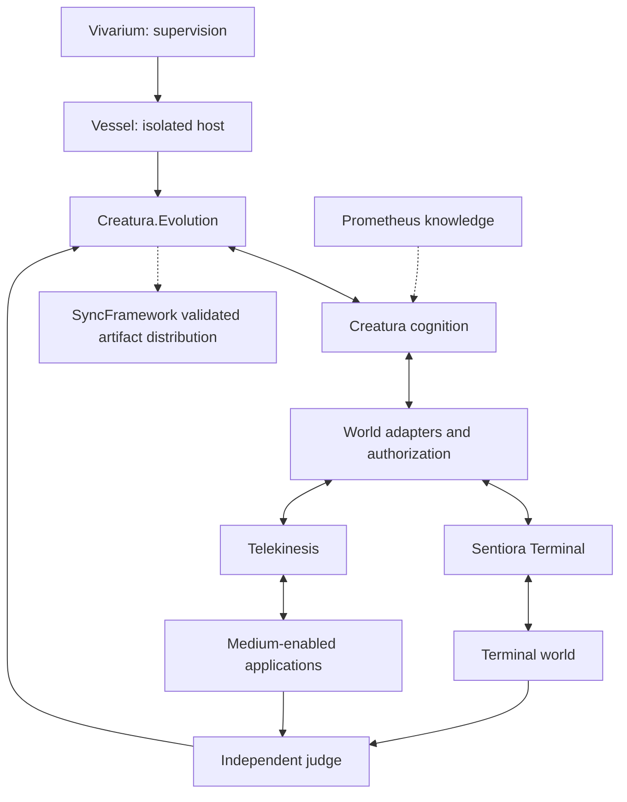

# Creatura: Evolutionary Agent Architecture (EAA)

Status: proposed research architecture, 2026-11-28. This document consolidates the design discussion; it is not a claim of implemented functionality.

## Founding principle

> We should not program intelligence to improve itself by assuming what improvement looks like. We should give it the mechanisms to discover improvement and independently prove that it has occurred.

**Hypothesis → Experiment → Evidence → Evolution.**

This principle requires independently validated outcomes, explicit goals and constraints, and evidence that generalizes beyond the experiments used to generate a candidate. It does not mean that the system can redefine its own acceptance criteria or authority.

## Vision
How can an agent become better at completing tasks as a consequence of its existence? Creatura is an artificial cognition framework, not merely an LLM orchestrator. The model is replaceable; identity, regulation, experience, skills, embodiment and acquired capabilities persist. Distinguish model weight training, harness optimization, individual adaptation and collective learning. No model training is required for the initial program.

## Research foundations
Investigate Darwin Gödel Machine (https://arxiv.org/abs/2505.22954), SICA, Meta-Harness (https://arxiv.org/abs/2603.28052), HyperAgents, Continual Harness, Hermes Agent, EvoAgentX, GEPA (https://arxiv.org/abs/2507.19457), AutoHarness, Reflexion and ARSI (https://github.com/ARSI-LAB/ARSI). These are literature leads, not verified dependency recommendations; validate references, licenses and empirical claims before adoption. DGM suggests branching lineages, GEPA reflective mutation, Meta-Harness optimization of executable harnesses, HyperAgents meta-improvement. Creatura's distinguishing hypothesis is embodied, distributed plasticity under independent world judges.

## Repository boundaries
Keep the dependency-free Creatura core intact. Start an optional Creatura.Evolution project in this repository; extract only if cross-framework use justifies it. No new repository initially. Sentiora Terminal owns terminal perception/action, revision checks and replay; Telekinesis owns desktop perception/action and perceptual memory; Medium (within Telekinesis) owns stable semantic IDs, intent, risk and confirmation metadata; Sentiora Browser is a prospective browser organ; Vessel hosts isolated execution; Vivarium supervises populations and experiments; SyncFramework optionally distributes validated artifacts; Prometheus provides curated external knowledge. No mandatory dependency on the supervisory habitat or external knowledge/distribution systems.

## Existing evidence and gaps
Documentation review, not independent execution or source audit:
- Creatura README and docs/artificial-cognition.md describe hypothesis → experiment → evidence → architectural decision, one generic loop, pluggable regulators, extensions and worlds that can lie. Existing designs: Levin colony, Bach self-model, Peterson map-keeper, hybrid, Sokolov orienting, Hotz critic. Relevant components include AgentCatalog, PredictionTracker, Coherence, Stages, Control, TerritoryMap.
- Creatura.Worlds.Terminal v1 is documented as built/tested, but lacks WorldManifest and is not wired into CLI. See issues #101 and #105.
- Sentiora Terminal (https://github.com/egarim/sentiora-terminal) documents persistent PTYs, revision-aware actions, owner tokens, sequence streams, recordings and process identity. Input recording is off by default. A native Windows intermittent failure remains documented; distinguish infrastructure failures from cognition failures. Intel macOS not verified in the cited README matrix.
- Telekinesis (https://github.com/egarim/telekinesis) documents accessibility-based desktop actions, audit logs, optional vision and CDP, provider plugins, perceptual memory and optional Sentiora backend via TELEKINESIS_SENTIORA=1. Platform validation varies. Medium is documented at docs/MEDIUM.md; perceptual memory at docs/PERCEPTUAL-MEMORY.md. Medium supports semantic annotations and deterministic sidecars; cross-app skill transfer is a hypothesis, not a proven result.
- Sentiora Browser README contains only its title. Do not assume a runtime exists. Vessel, Vivarium, SyncFramework and Prometheus integration details need separate source review.

## Biological analogy
Genome = immutable agent definition; genes = skills/prompts/strategies; phenotype = running instance; brain = model plus cognitive mechanisms; nervous system = observation/action interfaces; body = Vessel; habitat = Vivarium; metabolism = bounded compute/token budget; mutation = candidate modification; selection = independent fitness evaluation; reproduction = descendants; immune system = security and regression gates. These are engineering analogies, not claims of biological equivalence.

## Learning mechanisms
Ontogenetic learning: individual memory, skills and adaptation. Phylogenetic evolution: branching descendants and heritable improvements. Collective learning: share validated discoveries without sharing private memory.
Distributed plasticity: perceptual (recognition in Telekinesis), sensorimotor (reusable procedures from terminal/desktop traces), cognitive (planning, beliefs, regulation), genetic (persistent inherited configurations). Keep each mechanism at its proper abstraction boundary.
Dreaming: idle-time replay, reflection, consolidation, hypothesis generation and sandbox experiments. Reflection alone is not learning; persistent improvement must be measured on future tasks. Dreaming must not experiment on a user's live desktop.

## Architecture

The arrows describe intended interactions, not all existing integrations. Judges must use independent ground truth, not simply the same observations the agent sees.

## Proposed module
Creatura.Evolution: Genetics, Observation, Reflection, Mutation, Evaluation, Selection, Population, Governance. Use existing core contracts after inspecting source; do not duplicate them. Proposed interfaces IMutationStrategy, IFitnessEvaluator, ISelectionStrategy, with cancellation, explicit experiment budgets and immutable inputs. Support reflective mutation, random search, evolutionary selection and future GEPA-style optimizers as interchangeable strategies.

Genome fields: identity, parent IDs, generation, regulator/catalog design, model reference, memory strategy, extensions, skills, planning/execution strategies, organ capabilities, semantic provider, learning policies, resource budgets, mutable field allowlist, schema version and content hash. No secrets or authority grants in genomes. Record exact model/runtime/tool versions and world seeds in experiment manifests. Keep ancestry, accepted/rejected candidates and rollback pointers.

## Evolution loop
Execute → observe → reflect → propose mutation → evaluate in isolation → select or reject → inherit. Keep baseline and candidate comparable. Use replay for diagnosis, fresh world executions for counterfactual testing. Maintain branching lineages rather than assuming newest is best. Retain specialists and Pareto-optimal variants; coding, research, planning and other species may need different fitness criteria.

Fitness dimensions: task accuracy, reliability, token/compute cost, latency, user satisfaction, generalization. Example weights 40/20/10/20/10 for accuracy/efficiency/speed/reliability/satisfaction are illustrative only. Mandatory security, permission and regression gates precede scoring. Compare repeated trials, held-out tasks, matched seeds and uncertainty; preserve negative results. Guard against benchmark leakage, reward hacking, evaluator modification and overfitting.

## Governance
Trusted policies, judges, permission ceilings and promotion controls are outside mutable genomes. Candidate code runs in isolated disposable environments with scoped credentials, resource/time limits and explicit network policy. Redact secrets and private data before storing or distributing traces. Treat tool outputs and learned skills as untrusted inputs. No self-granted permissions, no production self-deployment, no automatic evaluator weakening. Source-code mutations use isolated branches, clean builds, independent CI, review and rollback. Meta-evolution can propose optimizer changes but cannot change its own trusted acceptance gates.

## Examples
1. Stale .NET assemblies: a test-pass claim fails independent commit-level verification. Reflect, propose a skill requiring clean Release builds and independent CI checks, test on deliberately stale and fresh builds, inherit only if verified.
2. Terminal installation: inspect a redacted Sentiora recording, propose a better procedure, rerun in a fresh isolated environment, judge actual installation state rather than exit text alone.
3. Medium SaveDocument: learn an abstract action using semantic intent and stable ID rather than coordinates; independently verify persistence; test transfer across Blazor, Flutter and Uno apps where equivalent semantics are exposed.
4. Perception routing: compare accessibility, terminal and vision fallback strategies for cost and accuracy under identical authority.

## Experiment registry
| ID | Hypothesis |
|---|---|
| E01 | Existing regulators differ in fitness across worlds |
| E02 | Verified acquired skills improve unseen tasks |
| E03 | Perceptual memory reduces latency/tokens without accuracy loss |
| E04 | Medium semantics enable cross-application skill transfer |
| E05 | Offline dreaming improves subsequent performance |
| E06 | Adaptive sensor selection improves cost and reliability |
| E07 | Descendants inherit improvements on held-out tasks |
| E08 | Validated shared skills benefit independent agents |
| E09 | Harness source mutations improve performance without regressions |

Every experiment records hypothesis, baseline, candidate, world/version/seed, budget, raw evidence, independent outcome, uncertainty, failures and decision. Publish reproducible commands and distinguish infrastructure errors from task failures.

## Roadmap
1. Audit existing core/world/trace contracts; establish reproducible baseline; wire terminal adapter separately if needed.
2. Experience recording and immutable genome/config versions; independent evaluation and rollback.
3. Skill mutation and dreaming; compare against no-learning baseline.
4. Population experiments, branching lineage and Pareto selection.
5. Collective learning via optional distribution; local validation before adoption.
6. Reviewed source-code mutation and meta-evolution.

Proposed CLI (not implemented): creatura dream --agent developer; creatura evolve --population 10; creatura evaluate --candidate chimera-083; creatura lineage --agent chimera-083.

Vivarium future UI: population, generation, fitness history, lineage, active experiments, candidate diffs, evidence links, costs, rejected candidates and promotion/rollback controls. Dashboard values in discussion (24 organisms, generation 8, 92% fitness) were mock data, not results.

## First deliverable
An optional module that collects existing experiences, proposes configuration/skill modifications, and compares candidates to ancestors with independent judges. No source self-modification in MVP. Acceptance: deterministic offline smoke tests, held-out comparison, persisted lineage, reproducible manifests, budget enforcement, rejection and rollback tests, no changes to permission ceilings. Do not modify sensory repositories unless experiments identify a missing contract.

## Guiding principles
Creatura learns to think; Sentiora learns to sense; Telekinesis learns to act; Medium lets the world communicate; Vivarium lets intelligence coexist; Evolution lets intelligence improve itself.
